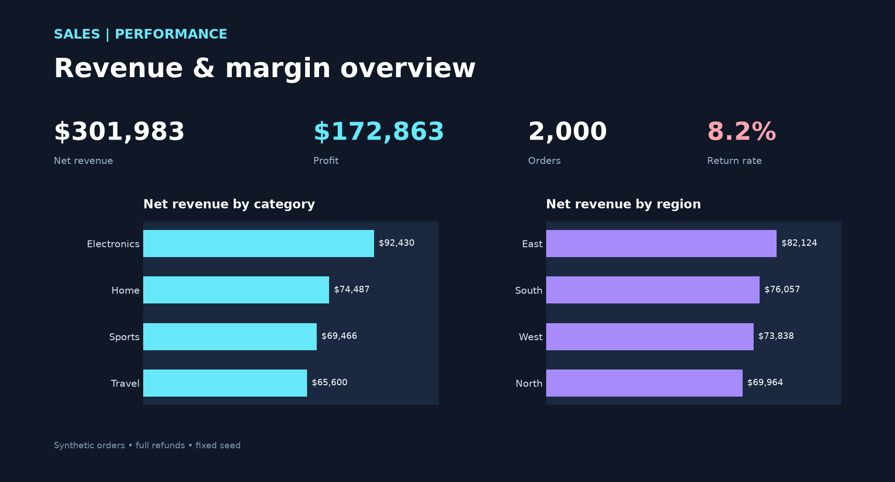

# Sales Performance BI

A reproducible sales and margin portfolio case using synthetic order lines. It asks where revenue and profit change by category, region and channel, while defining returns as full refunds.



`Fixed-seed Python generator → orders.csv → SQL/Python KPI reconciliation → Power BI-ready table → visual preview`

Each row is one unique order with one product line. Net revenue is gross line revenue less full refunds; returned lines also contribute no COGS. Profit is net revenue less COGS. Return Rate divides returned orders by all orders in the selected context. This is simulated data and is not a real store's performance.

## Run locally

Use Python 3.13:

```powershell
python -m venv .venv
.venv\Scripts\python.exe -m pip install -r requirements.txt
.venv\Scripts\python.exe -m src.sales
.venv\Scripts\python.exe build_preview.py
.venv\Scripts\python.exe -m pytest -q
```

The generator writes `data/orders.csv` and `data/kpis.json`; the preview renders from those exact files. `sql/reference_kpis.sql` independently computes the same definitions. [sales-performance.pbix](assets/sales-performance.pbix) is a native Power BI Desktop report with the 2,000-row dataset embedded, refund-aware DAX measures, KPI cards, category revenue, and regional profit charts. Open it in Power BI Desktop to explore the interactive dashboard. [POWER-BI-BUILD-GUIDE.md](POWER-BI-BUILD-GUIDE.md) documents the measures and ways to extend the report. The PNG is a separate static preview.

The test suite verifies a hand-calculated refund/profit case, reproducible unique order IDs, CSV totals and the independent SQL reference. The default dataset has 2,000 orders and uses seed 42.
